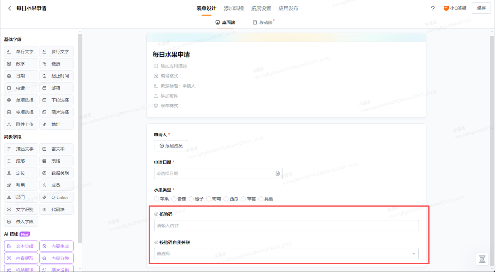
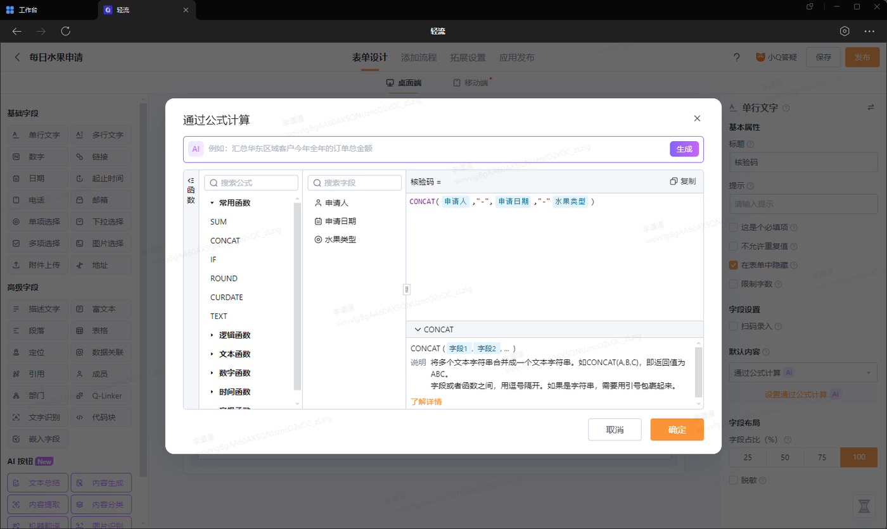
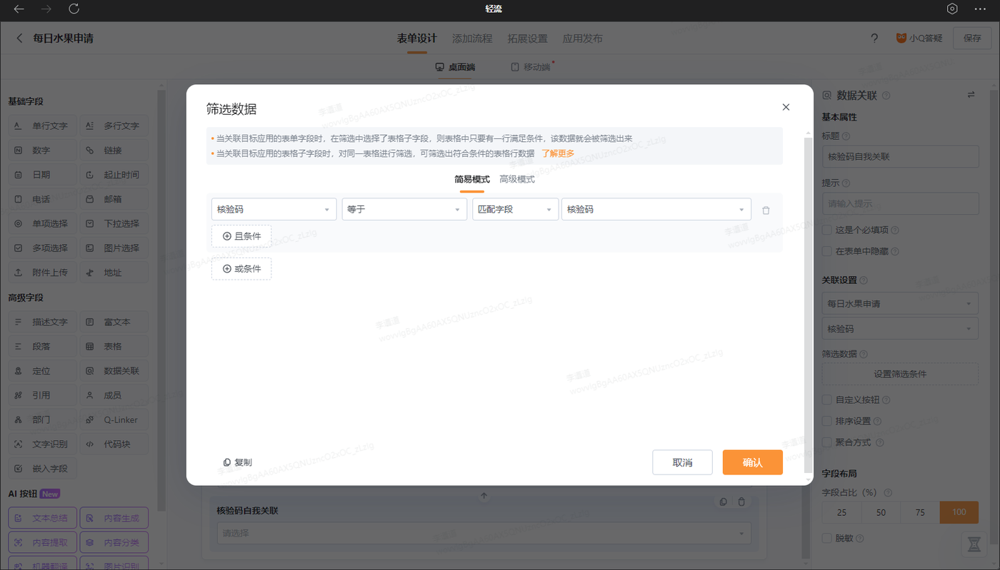
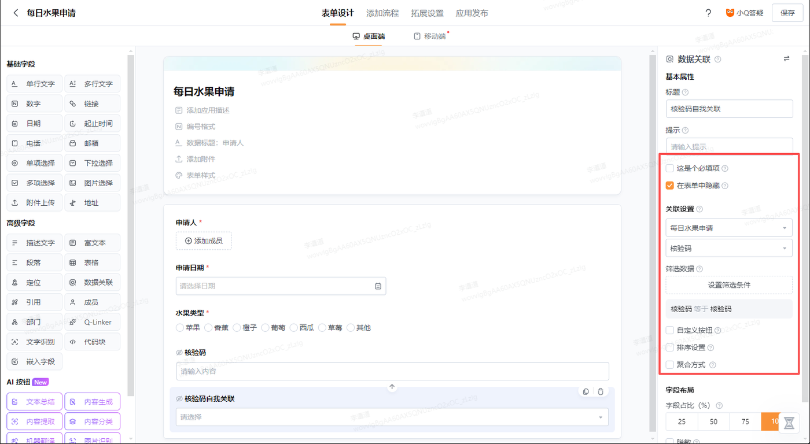
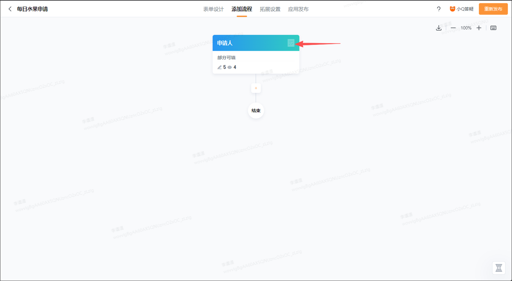
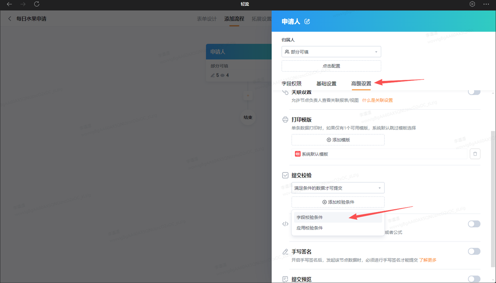
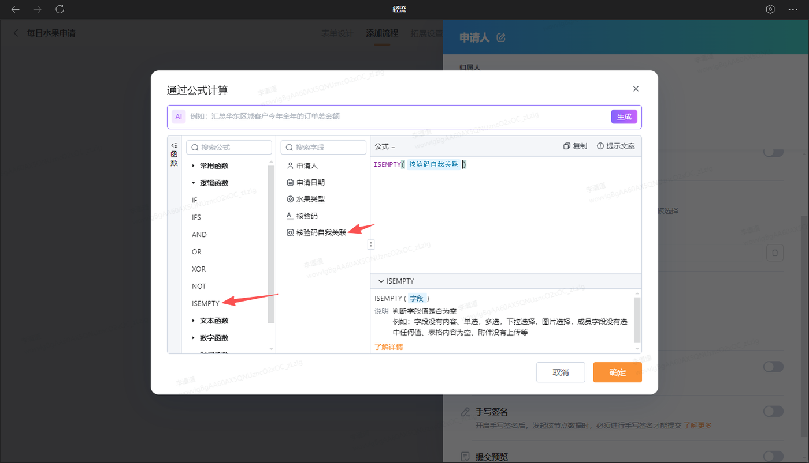
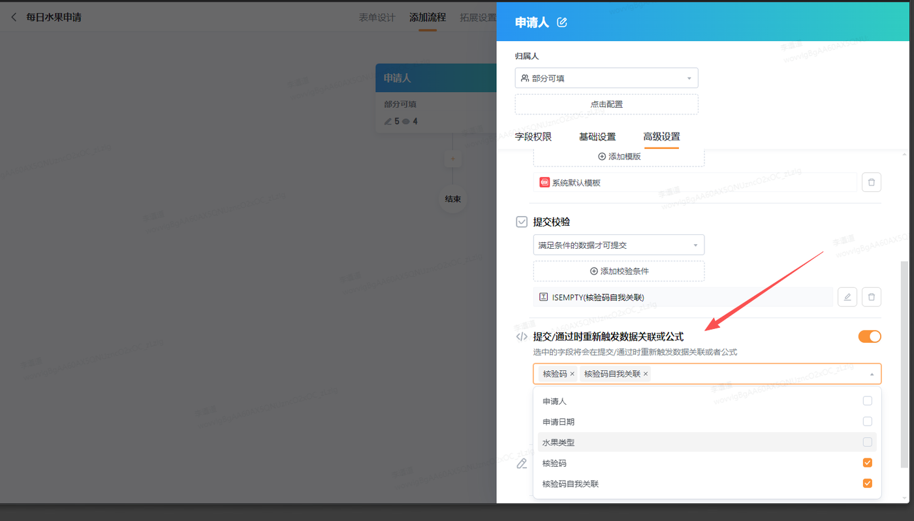

公司要做一个每日水果申请，规则就一句话：每人每天每种水果，只能提交一次。

在轻流里搭这个表单很快。申请人、申请日期、水果类型，三个字段加一条流程，半天就能发出去。

难的是那句话本身。翻了半天设置，字段校验里没有「几个字段合起来不许重复」这种开关——单字段去重有现成的，三样合在一起判重，平台不管。

规则是三个字段的交集：同一个人、同一天、同一种水果。要拦的，也得是这三样的组合。

## 先加两个隐藏字段

整个方案只往表单里添两个字段：一个单行文字，叫核验码；一个数据关联，叫核验码自我关联。都勾上「在表单中隐藏」，填表的人看不见，表单还是原来三样。

## 把三个字段拼成一个

核验码设成「通过公式计算」，把申请人、申请日期、水果类型用 CONCAT 拼成一串，中间用短横线隔开：

拼出来是「张三-2026-11-18-苹果」这样一串。同一个人同一天领两次苹果，核验码一模一样；换个水果，码就变了。三个字段的唯一性，落到了一个字段上。

## 让表自己查自己

拼出来之后，新的问题是：提交的时候，怎么知道以前有没有同款核验码？

轻流的「数据关联」字段，平时用来跨表取数。这里让它关联自己——核验码自我关联，关联目标还是「每日水果申请」这张表，取核验码字段，筛选条件就一条：核验码 等于 当前表单里的核验码。

这个字段同样不必填、在表单里隐藏。填表人一填完，它就去已提交的数据里找同款：找到，它就有值；找不到，它是空的。

## 拦在提交这一步

有了查询结果，拦截就简单了。

到「添加流程」里，点开申请人节点：

高级设置里找到提交校验，选「满足条件的数据才可提交」，添加一条校验条件，选「字段校验条件」：

条件是一条公式：

ISEMPTY(核验码自我关联)

关联字段是空的，说明库里没有同款，放行；有值，说明已经提过一模一样的，拦下。

## 一个容易踩的顺序坑

这套配置装完直接测，多半会漏拦——核验码还没拼出来，自我关联已经拿着空值去查了，查回来当然是空的，校验照样放行。

解决办法在节点设置的最底下：「提交/通过时重新触发数据关联或公式」，打开，把核验码和核验码自我关联两个字段勾上。提交那一刻，公式先算，关联重查，校验条件拿到的才是刚算完的结果。

这个开关不开，前面全白做。

## 机器人提交也要过这道闸

这套校验不挑提交方式。手动填表、Q-Robot 自动提交、API 提交，数据从表单入口进来，都要过节点校验——人工重复填会被弹回去，机器重复提交一样会被弹回去。

这正好能治另一个麻烦。源表单开了「监控表格变化」，一有变化就自动用 Q-Robot 往另一个应用里添加一条数据，当流水记账用。轻流的触发路数，是这张表单里的表格都提交一次——变化一来就是一批，流水应用里很快堆起重复记录，以前只能靠人工对账去清。

现在把核验码这一整套装在流水应用自己的表单上：Q-Robot 每次提交的字段是同一批，拼出来的核验码也相同，第二条在提交校验那里就被拦下，根本进不了库。流水应用可以放心开监控自动记账，重复的部分不用再人工清理，一些专门用来防重复提交的流水应用，直接省掉了。

## 收尾

最后表单还是原来三样：申请人、申请日期、水果类型。两个辅助字段藏在后台，填表人什么都感觉不到，重复的提交在节点上就被弹回去。

回头想，这是低代码平台缺开关时的通用路数：平台没有的判断，用拼字段造出钥匙，用自关联造出查询，用提交校验造出闸门。换别的规则也一样——每人每周每类、每客户每产品每月，改一下 CONCAT 里拼的字段就行。
