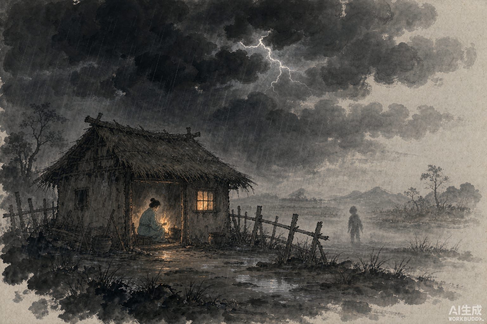

夜里一更天，篱笆外有个小孩在喊：阿香。

屋里的人应了一声。隔了一会儿，那小孩又说：官府叫你去推雷车。

这事得从头讲。义兴有个姓周的人，从都城回来，骑着马，带着两个随从。天黑了，村子还远，他要去的地方叫临贺，照这个走法，今晚是赶不到的。路边立着一间新搭的草屋，一个姑娘出门来，十六七岁的样子，模样端正，衣服干净。她看见周某经过，说：天已经晚了，前村还远着，临贺哪能赶得到？

周某就在这里借宿。姑娘生火做饭，饭是热的，屋子是干净的。

一更天，篱笆外来了那个喊阿香的声音。姑娘应了，那边传话：官府叫你去推雷车。姑娘起身说：我有事，得出去一趟。

这一夜，雷声大作，暴雨下了一整夜。

天亮，姑娘回来了。周某上马赶路，回头去看昨晚借宿的地方——没有草屋，没有姑娘，只有一座新坟。坟口有马撒的尿，散着几根吃剩的草料。

周某愣在马上，半天没说话。

五年之后，他果然做了临贺太守。
