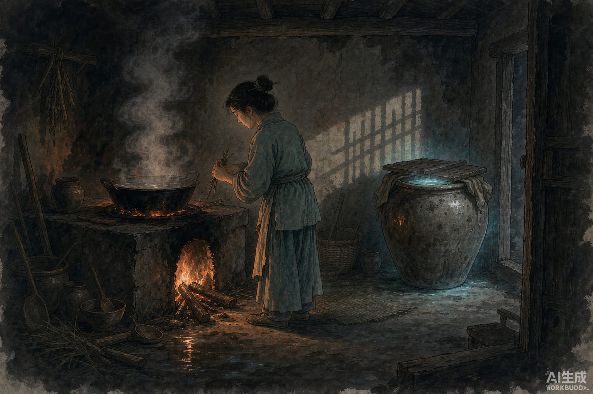

侯官人谢端，小时候父母都死了，没有亲戚，是邻居把他养大的。

长到十七八岁，性子恭谨，不干违法的事。他搬出来自己住，没有娶妻，邻居们都替他惦记，想给他说一门亲，一直没成。他起早贪黑，一心种田，白天黑夜都不歇。

有一回他在城外捡到一只大螺，有装三升酒的壶那么大。他觉得这东西稀奇，带回家，养在水瓮里。

过了十几天。他每天早上出门，晚上回来，锅里都有饭，有汤，灶里的火还是热的，像有人做过。

他以为是邻居帮的忙，去道谢。邻居说：我没做这事，你谢我做什么。他以为邻居不肯认，可一连好些天都是这样，他就认真问了一次。邻居笑了：你自己娶了媳妇，藏在屋里做饭，倒说是我做的？

谢端没话说，心里发闷，不知道是怎么回事。

后来他鸡叫就出门，上午悄悄折回来，躲在篱笆外面往自家看。

一个少女从瓮里出来，走到灶下生火。

他推门进去，直奔水瓮，看那只螺——只剩一个空壳。他到灶下问她：新娘子从哪里来，为什么替我做饭。

女子慌了，想回瓮里去，回不去了。她说：我是天河里的白水素女。天帝看你这人从小孤苦，做事又谨慎守规矩，让我暂时替你看家做饭。十年之内，让你家里富足，娶上媳妇，我再回去。你无缘无故偷着看，我的形已经露了，不该再留下，这就得走了。不过往后你自己的日子会好一些，好好种田，打鱼、采柴，过日子。这个壳留给你，用来装米谷，常常可以不断。

谢端求她留下，她始终不肯。天上忽然起了风雨，一下就走了。

他给她立了神座，按年节祭祀。家里常常够吃，也没有大富。乡里人把女儿嫁给了他，后来他做官做到县令。

现在福州还有个地方叫螺洲，江边有座螺女庙。
