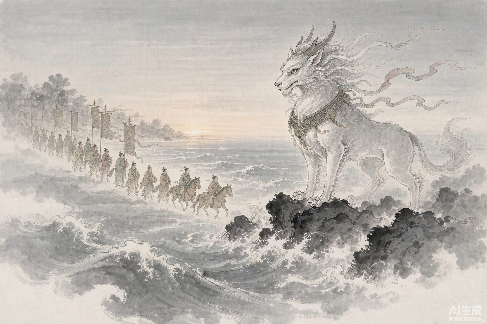

黄帝巡视天下，走到东海边，登上桓山。在海滨，遇见一头兽。

这头兽会说人话，天下万物的情理，它都通。黄帝就问它鬼神的事——自古以来，由精气凝成的、由游魂变化出来的东西，一共有一万一千五百二十种。白泽一种一种地说过去：名字，长相，来路，还有见了它该怎么办。

黄帝听完，命人照它说的画成图，颁行天下。又亲手写了一篇《祝邪之文》。

这段记载见于宋人编的《云笈七签》，引自《轩辕本纪》。更早的线索在晋代葛洪的《抱朴子》里：「穷神奸则记白泽之辞。」要把那些害人的精怪分辨清楚，靠的是白泽说过的话。

那本图后来就叫《白泽图》。中古的时候流行到几乎家手一册。人在外面撞见形状古怪的东西，回家翻开图，按图索骥：叫什么名字，怕什么，用什么法子退它。禅宗语录里留下过三句话：「家有白泽图，妖怪自消除。」「不悬肘后符，何贴白泽图。」「家无白泽图，有如此妖怪。」最后一句是骂人的——你家连白泽图都没有，难怪出这种妖怪。

后来白泽进了帝王的仪仗。唐开元年间，天子出行，前驱的旗队里有一面白泽旗。明代的官服补子上也绣它，公、侯、伯和驸马用，取的是明察事理的意思。

至于它长什么样，书上越传越乱。有说虎首朱发、身子像龙的，有说龙首绿发、头上戴角的，有说狮身、生着双翼的。反正没有人见过真的。图上那些妖怪早就散了，白泽的样子怎么传都不要紧。

敦煌莫高窟后来出过一卷《白泽精怪图》的残卷，现在存放在法国国家图书馆。纸上的妖怪残了大半，认得出名字的没有几个。全本要是还在，照白泽报的数，一万一千五百二十种，不知道该有多厚。
