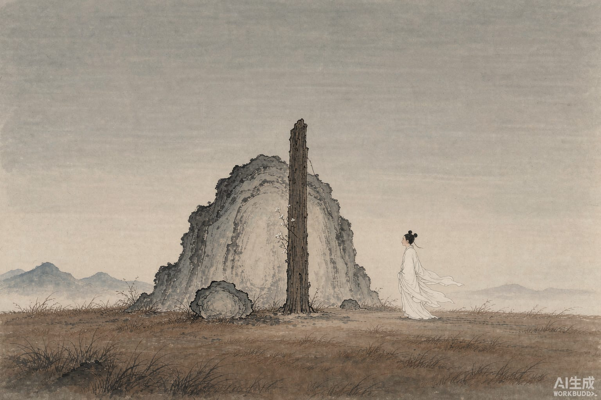

「凭我的才学和相貌，能见张司空一面吗？」

问这话的，是燕昭王墓前的一只斑狐。它修炼多年，能变化，化作一个书生，路过墓前的华表，先跟这根老木柱商量。

华表劝它：你的才思，没有什么去不得。可张公的心智，怕不是你能周旋的，去了必受屈辱，多半回不来。丢了一千年的修行不说，还要连累我这根老木头。

狐不听，拿着名帖去了。

张华是晋惠帝时的司空，一见这书生，总角风流，肌肤洁白如玉，举止从容，眼波一动都有风姿，很是看重。两个人论文章，辨声实，张华从没听过这样的见解；再谈三史，探百家，说老庄的幽微，揭风雅的精要，张华句句接不上。他叹了一声：天下哪有这样的少年？不是鬼魅，就是狐狸。

当下扫榻留客，暗中派人守住房门。

书生说：明公该尊贤容众，嘉善而矜不能，怎么反倒忌恨别人有学问？墨子讲兼爱，是这样讲的吗？说完就要走，门已经被人守住，出不去。他又说：公门前摆着甲兵栏骑，是疑心我。这样下去，天下人闭着嘴不敢说话，有谋略的人到门口就回头，我为明公可惜。

张华不答，守得更严。

正巧丰城令雷焕来访，这个人博学多识。张华把书生的事说了。雷焕说：既然疑心，为什么不放条猎狗试试？狗放进去，书生毫无惧色。狐说：我天生的才智，你们当我是妖，拿狗来试我，千试万虑，能把我怎样？

张华听了更怒：这一定是真妖。都说魑魅怕狗，可狗只辨得出几百年的东西，千年的老精它辨不了。只有用千年的枯木照它，原形立刻现出来。

雷焕问：千年的神木，哪儿找去？

张华说：世传燕昭王墓前那根华表木，已经一千年了。派人去砍。

使者快到的时候，空中忽然出来一个青衣小儿，问：你来做什么？使者照实说了。小儿哭起来：老狐不智，不听我的话，今天祸已到我头上，还逃得掉吗。哭声一停，人也不见了。使者砍那根木头，木里流出血来。

木头运回来，点着，就着火光一照——书生是一只斑狐。

张华说：这两样东西要不是撞上我，一千年也遇不着。把狐狸煮了。
