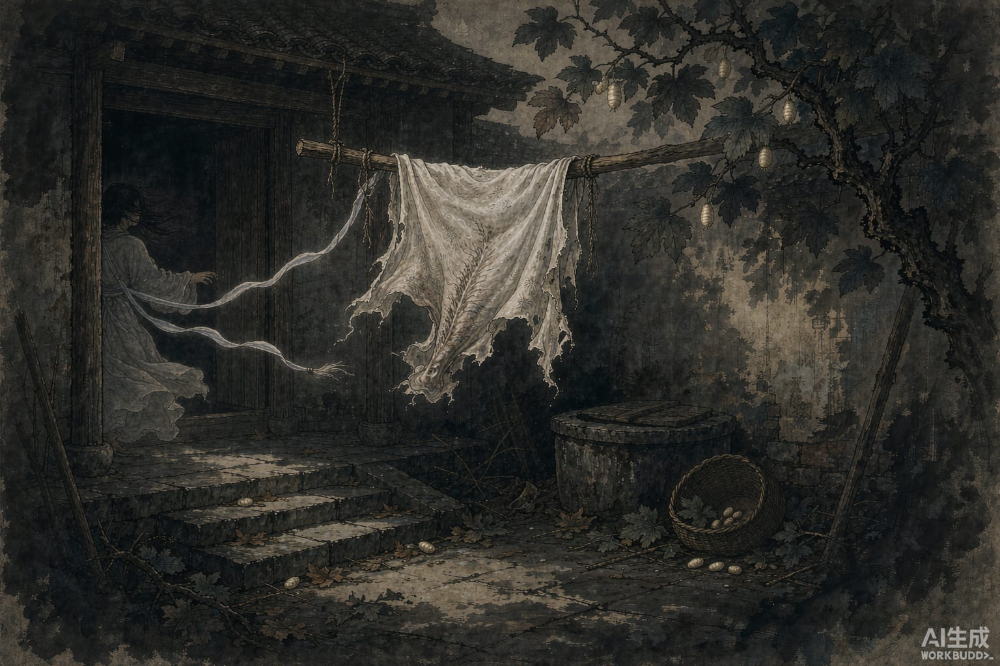

一句玩笑话，一匹马当了真。

太古的时候，有个人远征在外，家里只剩一个女儿，和一匹她亲手养大的公马。日子过得冷清，姑娘想父亲，就对马说：你要是能把我父亲接回来，我就嫁给你。

马听完这句话，挣断缰绳就走了，一直跑到父亲那里。父亲见了马又惊又喜，翻身骑上。马一个劲儿朝来的方向悲鸣。父亲心里发慌：这马好好的这样叫，家里不会出事了吧？赶紧骑回家。

按说畜生对主人有这份情，该好好喂养。草料加厚了，马却不吃。每回见了姑娘出入，又踢又跳，忽喜忽怒，不是一回两回。

父亲觉得奇怪，私下问女儿。女儿把那句话说了：一定是为了这个。父亲说：这事别再提，说出去丢家里的脸。你也别再出门了。

然后他埋伏下弩，把马射死了，剥下的皮晾在院子里。

父亲出门后，姑娘和邻居家的女孩在马皮旁边玩，姑娘用脚踢了踢那张皮，说：你是个畜生，还想娶人做媳妇？招来剥皮的祸事，怪谁呢。

话还没说完，马皮猛地卷起来，裹住姑娘就跑。邻家女孩吓坏了，不敢去追，跑回去报信。等父亲回来找，人早就没了。

几天后，人们在大树的枝叶间找到了——姑娘和马皮，都变成了蚕，在树上吐丝。茧又厚又大，跟寻常的蚕不一样。邻居家妇人拿回去养，收成翻了几倍。

那棵树从此叫桑。桑，就是丧。

百姓抢着种它，就是如今养的蚕的来历。旧时的人管蚕叫女儿，说起来，也是从这件事上留下的。
