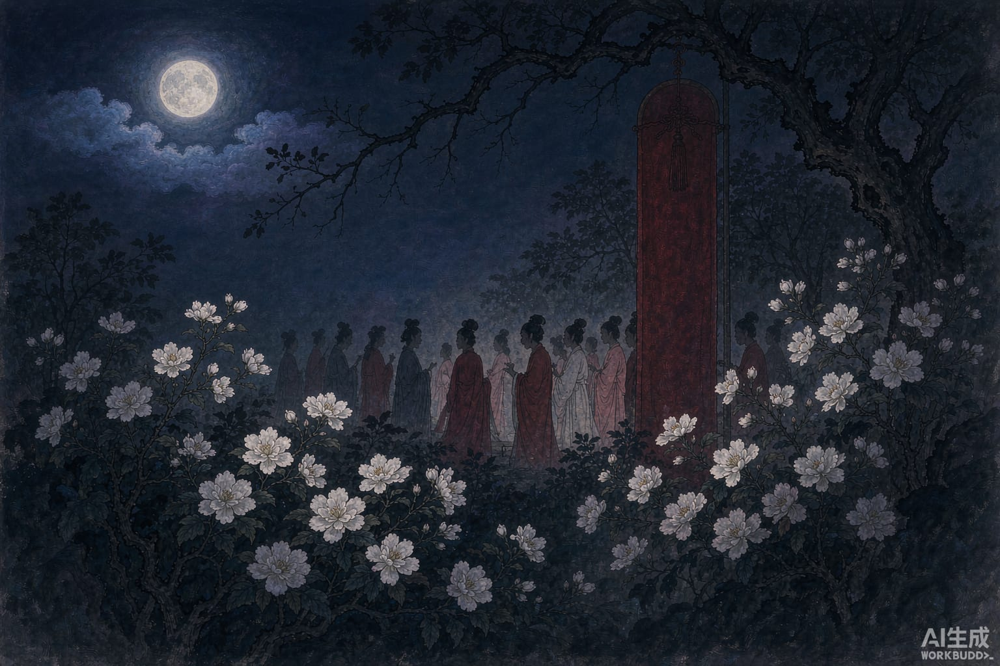

唐天宝年间，洛阳城东住着一位处士崔玄微。他一心求道，吃白术和茯苓三十年。这一年药吃完了，他带着僮仆进嵩山采灵芝，一去一年。回来时宅子里空无一人，院子里长满了荒草。

春夜，风清月朗，他睡不着，独自坐在院中。三更之后，来了个青衣婢女，站在门外问：先生还在院里，我们想带一两位女伴借这里歇歇脚，往东门看一位表姨，行吗？崔玄微答应了。

一会儿来了十几个女子。为首的绿衣裳，自称姓杨；又一位姓李，一位姓陶；还有一个穿绯红衣裳的小姑娘，姓石，叫阿措。她们说要去拜访封十八姨，今晚正好路过。坐定没多久，门外通报：封家姨到了。众人惊喜出迎。

这位封姨言谈清冷，有林下风气。满座女子个个容貌出众，芳香袭人。众人摆酒，轮流唱歌，有红衣人唱道：「自恨红颜留不住，莫怨春风道薄情。」

轮到封姨举杯，她性子轻佻，一杯酒泼出来，污了阿措的衣裳。阿措当场翻脸：诸位我都给面子，唯独她不行。说完拂衣就走。封姨只说了句：小丫头撒酒疯。众人不欢而散，封姨往南去，其余的往西进了苑中。崔玄微没觉得有什么不对。

第二天夜里她们又来，说还要去封姨那儿。阿措火了：何必再去那个老太婆家里！有事直接求处士不行吗？原来她们都住在苑中，每年都被恶风摧残，住不安生，向来靠封姨庇护。这次翻了脸，只好求别人。她说：请您每年岁日做一面红旗，画上日月五星，立在苑东，就能免难。今年的日子过了，请在这个月二十一日，清晨微微起东风时立起来。

崔玄微答应了。众女齐声道谢，他送她们出门，看着她们翻过苑墙，一进去就都不见了。

他照办了。到了二十一日，东风大作，洛阳城南折树飞沙——苑里的繁花纹丝不动。

崔玄微这才明白：姓杨的是杨柳，姓李姓陶的是李花桃花，红衣的阿措是石榴，那位封姨，就是风神。

过了几夜，杨氏带着众人来道谢，各裹了一斗桃李花送他，劝他服下去，能延年却老。她们只求他长住下去，继续照看这片园子。到元和初年，崔玄微还在，看上去也就三十来岁。
