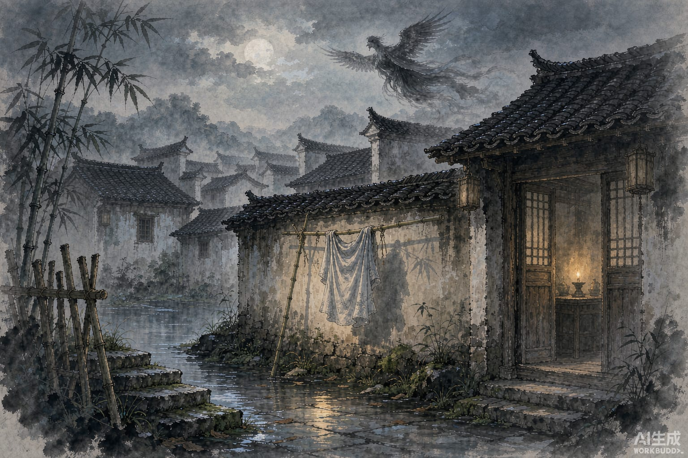

小孩子的衣服不能晾在外头过夜。

这话很多地方都有人讲，讲的时候常常说不上为什么，只说是老规矩。老规矩是有源头的，晋代郭璞的《玄中记》里写着。

书里说，天下有一种女鸟，叫姑获。夜里飞，白天藏，算鬼神一类。穿上毛羽是飞鸟，脱下毛羽是女人。名字有好几个：天帝少女、夜行游女、钩星、隐飞。它自己没有孩子，喜欢把别人的孩子偷去养，当自己的。所以那时候的人家，小儿的衣服不肯在夜里晾在外头——这东西喜欢用血在小孩衣服上点一个记号，点了记号，夜里就来取。世人叫它鬼鸟，荆州一带最多。

唐代段成式在《酉阳杂俎》里又补了几句：这鸟胸前有乳；喂孩子的人不能把孩子露在外面，小孩的衣服也不能露天晒，毛落在衣服里就要作祟。还有一说，它是难产死掉的女人变的。

接下来才是那个故事。

豫章有个男子，在田里看见六七个女人。他不知道是鸟，趴着身子慢慢挪过去，先拿到其中一个脱下的毛衣，藏起来，再起身走过去。那几个女人各自找到衣服，穿上就飞走了。只剩一个，衣服没了，走不掉。男子把她带回家，做了妻子。

后来生了三个女儿。

这些年里，她没提过那件衣服。一直到女儿长大，她才让女儿去问父亲：衣服藏在哪儿。

她没有自己去问。父亲对女儿会说实话，对妻子未必。

女儿问出来了：在稻堆底下。她找出来，穿上，飞走了。

飞走以后，她又回来接三个女儿。女儿们拿到衣服，也飞走了。

书上到这里就完了，没写那个男子后来怎么样，也没写她们飞去了哪里。整篇里只剩下开头那一句还有用——小孩子的衣服，别在夜里晾在外头。
