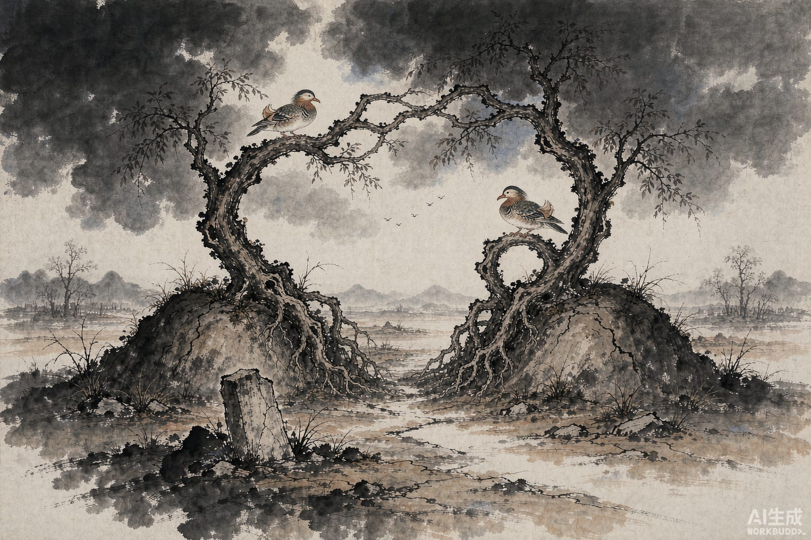

宋国的康王，看上了自己门客韩凭的妻子何氏。

人夺过去了。韩凭有怨言，王把他关起来，定罪送去筑城。

何氏托人给丈夫递了一封信，话说得很绕：其雨淫淫，河大水深，日出当心。

信落到王手里。王给身边的人看，没有一个人看得懂。有个叫苏贺的臣子说：久雨不停，是说心里愁，也想他；河大水深，是说隔着河，见不着面；日出当心，是向着太阳起誓，心里已经有了死的意思。

没过多久，韩凭自杀了。

何氏悄悄把自己的衣裳弄朽了——一扯就烂的那种。王带她登台，她从台上跳下去，左右的人伸手去拉，衣料在手里散开，没抓住。她死在台下。

衣带上留了话：王想让我活，我想让我死。求你把我这把骨头，赐给韩凭，合葬。

王大怒，不听。他叫乡里的人把两人分开埋，两座坟遥遥相望。王说：你们夫妻不是相爱不止吗？要真能让坟合到一块儿，我不拦。

一夜之间，两座坟头各长出一棵大梓树。十来天，粗得两臂抱不过来。两棵树弯着身子向对方靠，根在土底下交错，枝在头顶上交错。

树上住了一对鸳鸯，一雌一雄，早晚都不飞走，交着脖子叫，声音让人听着难受。

宋国的人可怜他们，管这两棵树叫相思树。相思这个词，就是从这儿来的。

南边的人说，那对鸟就是韩凭夫妇的魂。

两座坟始终隔着一段距离，谁也没挪。挪的是树。
