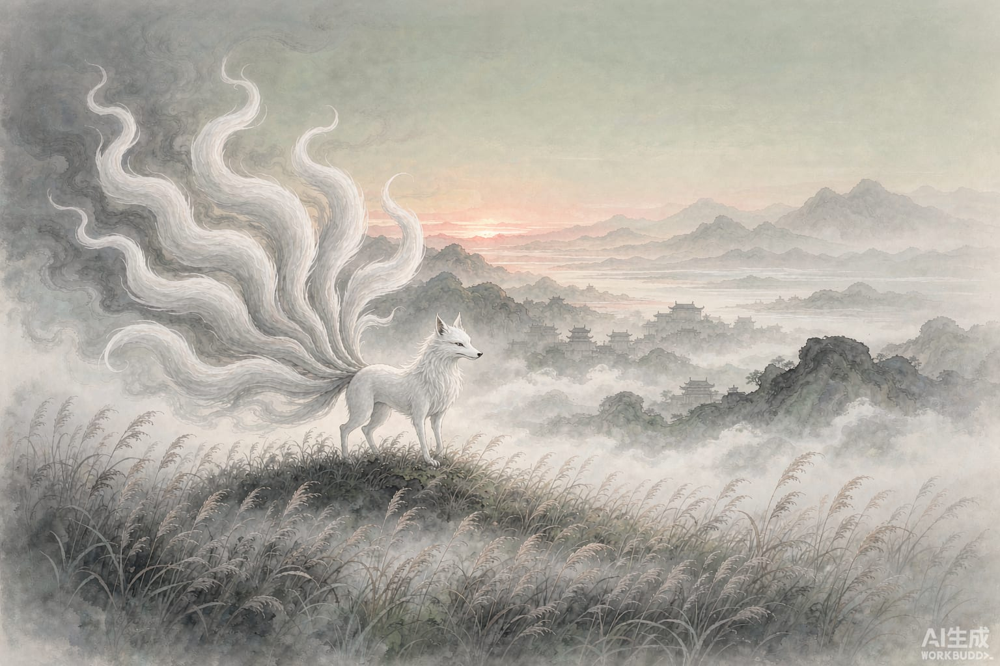

大禹三十岁，还没有娶妻。

古人成家早，三十未婚，他自己也着急。走到涂山的时候，他说了一句：我娶妻，必有天意来应。话音刚落，一只九尾白狐出现在他面前。

禹看着它说：白色，是我衣服的颜色；九条尾巴，是称王的证验。涂山当地流传着一首歌：「绥绥白狐，九尾庞庞。成家成室，我造彼昌。」白狐大摇大摆地走到跟前，这就是说亲来了。

禹于是娶了涂山氏的女儿，名叫女娇。

《山海经》里记过这只狐，长在青丘之山，样子像狐狸，拖着九条尾巴，叫声像婴儿啼哭，会吃人；但人若吃了它的肉，可以不受妖邪蛊毒的侵害。

同一只兽，两副面孔：一边是吃人的异兽，一边是婚姻与王业的吉兆。后来的几千年里，它一直在这两副面孔之间摇摆——汉代人把它跟麒麟、凤凰刻在一起，当作太平的祥瑞；唐宋往后，又慢慢变回魅人的妖怪，再往后，就有了妲己。

涂山这边的故事还有一个尾声。禹成婚后四处治水，长年不回家。女娇派侍女到涂山南坡守着路口等他，等来等去，唱成了天下第一首情歌，只有四个字：

候人兮猗。

——我等的那个人啊。
