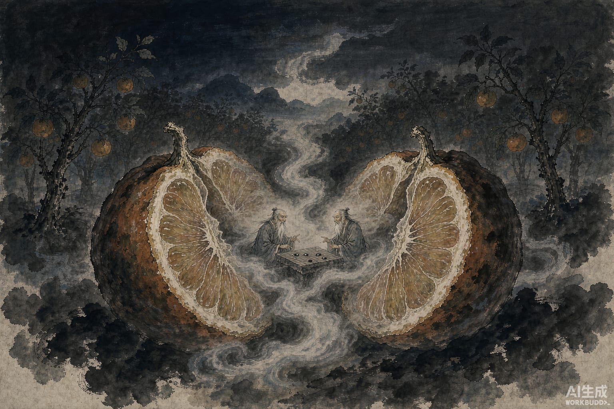

唐朝有个故事说，巴邛这地方，有个人家有一片橘园。

下霜之后，橘子都收完了，树上剩下两个特别大的，有装三斗的罐子那么大。这人觉得奇怪，让人摘下来。一掂，分量和平常橘子一样。

剖开一看，怪事来了。

每个橘子里，都坐着两个老先生。白胡子白眉毛，脸色红润，身长一尺多。他们正面对面下象棋，谈笑自若。

橘子被剖开了，四位老先生一点也不惊慌。他们先把手里这盘棋下完，还按规矩赌了个输赢。

赌完，一位老先生慢悠悠地说：你输了，欠我龙王第七女的头发十两、智琼额黄十二枝、紫绢帔一副、绛台山霞宝散两庾、瀛洲玉尘九斛、王母疗髓凝酒四钟、龙缟袜八双——后天在王先生青城草堂还我。

听听这个赌注。输了棋，赔的头发是龙王女儿的，酒是王母酿的。可见这几位来头都不小，平时也这么玩。

然后另一位老先生叹了口气，说了句流传很广的话：

"橘中之乐，不减商山，但不得深根固蒂，为愚人摘下耳。"

住在橘子里的乐趣，不比商山四皓差。只是根扎得不深不牢，被几个愚人摘下来了。

他们抱怨的就是这一句。家没了，赖的是自己根没扎稳，不是主人摘得不对。连生气，都懒得出。

第三位老先生说：我饿了。说着从袖子里抽出一根草根，一寸见方，弯弯曲曲像条龙，头尾鳞爪清清楚楚。他就这么削着吃，削掉多少，长回多少。

吃饱了，老先生含一口清水，噗地喷在那根草根上。草根化作一条龙。四位老先生骑上龙背，脚下云雾腾起，转眼风雨大作，谁也不知道去了哪里。

地上那位园主，从头到尾没说上一句话。

这个故事我最喜欢的地方，是他们被剖出来时的反应。换个人，哪怕换只妖，家园被劈成两半，怎么也得先怒喝一声。这四位不。棋先下完，赌注先记好，饿了吃饭，吃完了走。

走之前只留下一句抱怨：怪我们根没扎稳。

其实哪是根没扎稳。是这世道，连橘子都留不住想清静的人。
