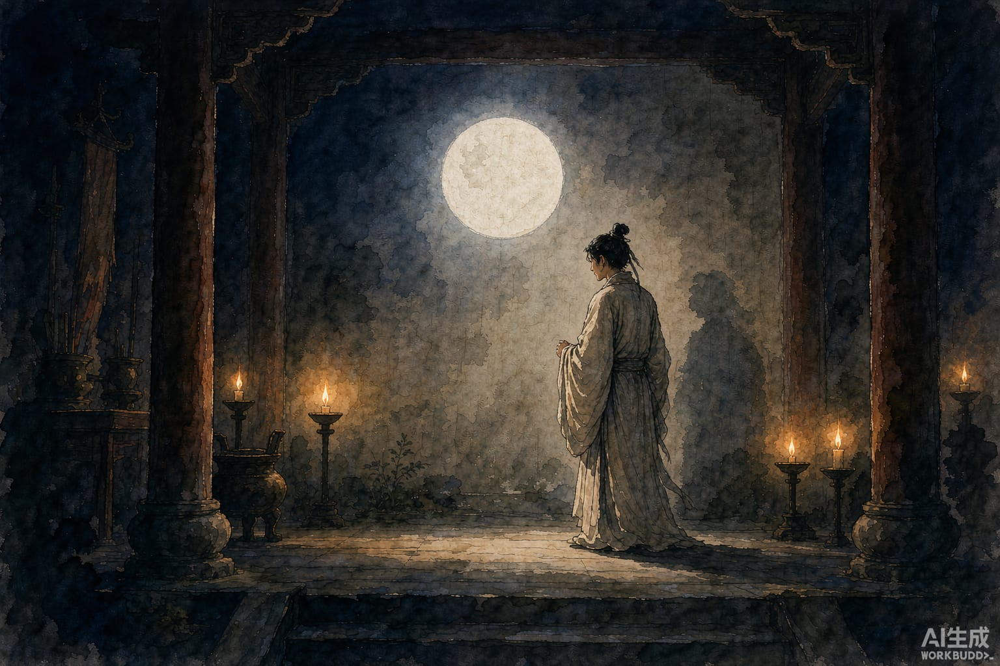

王七是本县的富家子弟，排行第七，从小慕道。听说崂山上多有仙人，他背起书箱就去了。

山上一座道观，很幽静。一位道士坐在蒲团上，鹤发童颜。王七叩头请求收留。道士说：只怕你娇气懒惰，吃不了苦。王七答：我能。

当晚安排住下。天一亮，师父给了他一把斧头，叫上山砍柴。

这样过了一个多月，手上磨出厚茧，王七熬不住，起了回家的念头。

有天傍晚他砍柴回来，看见师父家里来了两位客人，天已经黑了，屋里没点灯。师父剪纸圆如镜子，往墙上一贴，满屋月光明亮，纤毫毕现。一位客人说：良宵美景，不可独乐。拿起壶给每个徒弟分酒。王七心里嘀咕：七八个人，一壶酒哪够？众人找碗找盂，抢着倒——酒来来回回地倒，竟一点也不见少。

另一位客人说：有月亮相伴还是寂寞，何不把嫦娥请来？说着拿一根筷子往月亮里一掷。一位美人从月光里飘出来，起初不满一尺，落了地，就与常人一般高，跳起霓裳舞，歌声清越如箫管。唱完盘旋着跃上桌案，众人一惊，再看，又是那根筷子。

三人哈哈大笑。又一人说：今晚最乐，可惜不胜酒力，送我们进月宫里喝如何？三人移席，渐渐进了月亮。徒弟们看着他们坐在月中饮酒，胡须眉毛都看得清，像映在镜子里。

月亮渐渐暗下去，徒弟点上蜡烛——屋里只有师父一个人坐着，客人已经不在了，桌上菜核还原样摆着，墙上那张纸圆如镜子。师父问：都喝足了吗？众徒说：足了。师父说：足了就早点睡，别误了明天砍柴。

王七满心欢喜，回家的念头打消了。可再过一个月，又熬不住了，师父还是什么都不教。他告辞说：弟子来了两三个月，每天上山砍柴，天黑才回，在家没吃过这种苦。师父说：我说你不能吃苦，果然，明天一早送你走。

王七不甘心：操作了这么多天，请师父略传一技，也不算白来。道士问想要什么。王七说：常见师父走到哪里，墙壁都拦不住。学会这个就够了。

道士笑着教了他一句口诀，叫他念完喊一声「入」，往墙上走。王七走到墙前，不敢迈步。道士说：低下头，猛往里冲，别犹豫！王七退开几步，一头奔过去——墙像不存在一样。回头一看，人已经在墙外头了。他大喜，回来拜谢。师父叮嘱：回去要洁身自持，不然不灵。

到家，王七逢人就讲自己遇了仙，铜墙铁壁都拦不住他。妻子不信。他退开几尺，照着口诀猛冲过去——

咚。头撞在墙上，摔了个仰面朝天，额上鼓起一个包，像半个鸡蛋。

妻子笑得直不起腰。王七又惭又恼，骂了几句老道士没良心，这事才算完。
