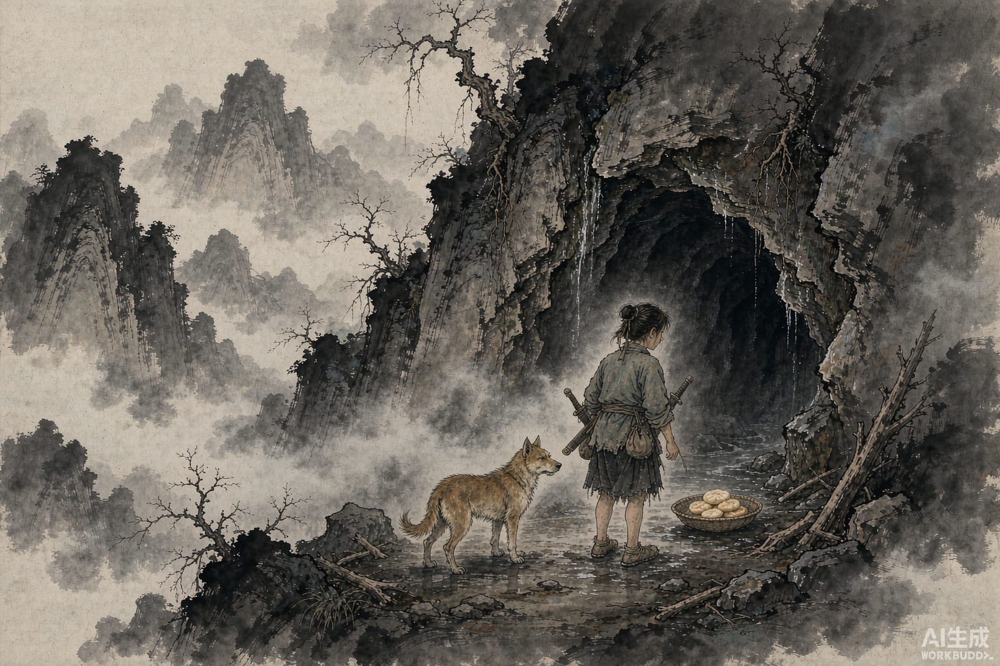

庸岭在闽中，山高几十里。山的西北面有一道低湿的石缝，缝里住着一条蛇。

七八丈长，十几围粗。当地人怕它怕了很多年。东冶的都尉和县城里的官吏，死在它手里的不止一个。人们拿牛羊去祭，不管用。后来蛇托梦给人，又借巫祝的嘴说话：它要吃十二三岁的女孩。

官府的都尉、县令、县长凑在一起商量，谁也想不出办法，蛇的凶气一天没停。最后定下一个规矩：找奴婢生的女儿，或者罪人家的女儿，养着，到八月初一，送到洞口。蛇出来，吞掉。一年一个，这样过了很多年，已经用掉九个。

这一年又要征人，还没定下是谁家。

将乐县李诞家有六个女儿，没有儿子。最小的那个叫李寄，说要去。父母不许。李寄说：家里没有儿子，六个女儿顶不上一个；我没有缇萦那样救父的本事，也供养不了你们，白吃饭，白穿衣服，活着没一点用处，不如早点死。把我卖了，还能换几个钱给家里，有什么不好。

父母心疼她，还是不放。她自己偷偷走了，拦不住。

她跟人要了一把好剑，又要了一条会咬蛇的狗。

八月初一，她走进庙里坐下，剑揣在怀里，狗带在身边。事先做了几石米糍，拌上蜜炒的米粉，放在洞口。

蛇出来了。头大得像谷仓，眼睛像两尺宽的镜子。闻到糍的甜香，先低头去吃。

李寄放狗。狗扑上去咬，她从后面砍了几剑。蛇吃了痛，跳起来，蹿到院子里，死了。

她走进洞去看。九个女孩的头骨都在里面。她一个个抱出来，说：你们太胆小了，被蛇吃掉，真是可怜。

然后她慢慢走回家。

越王听说了这件事，聘她做了王后，她父亲做了将乐县令，母亲和姐姐都有赏赐。东冶从此再没有出过妖邪。那首歌谣，一直到干宝写书的时候还有人唱。
