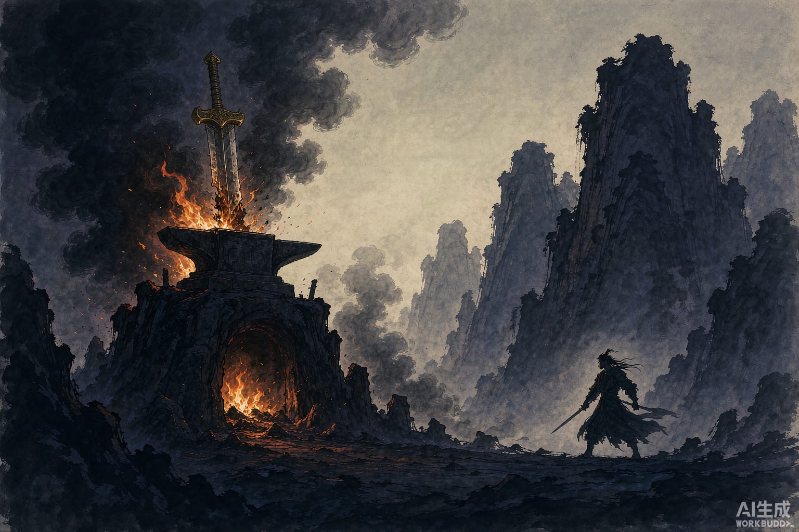

干将为楚王铸剑，一铸就是三年。

剑成的时候是两把，一雌一雄。干将对妻子莫邪说：我送去的是一把，楚王要的是一把，见他只见着一把，必定发怒，我这条命保不住。你若生下男孩，等他长大，告诉他：出门朝南山望，松树长在石头上，剑就在松树背后。

他带着雌剑去了。楚王叫相剑的人验看，那人说：剑本有两把，一雄一雌，如今只来了雌的，雄的不见。楚王大怒，把干将杀了。

莫邪果然生了个男孩，取名赤。赤长大了，问母亲：父亲呢？母亲把当年的话说了一遍。赤出门朝南望，没有山，只有堂前一根松木柱子，立在石头上。他抡起斧头劈开柱背，里面藏着那把雄剑。

从此他日夜想着报仇。

这话不知怎么进了楚王的梦。王梦见一个少年，两道眉毛隔得老远，眉间足有一尺宽，梦里说要杀他。楚王惊醒，悬赏千金捉拿。赤听见风声，逃进山里。

他在山里走着，悲愤没处发，边走边唱。有个过路人停下问：看你年纪不大，哭得这样伤心，遭了什么事？赤说：我是干将莫邪的儿子，楚王杀了我父亲，我要报仇。那人说：楚王正悬赏千金要你的头。把你的头和剑给我，我替你报。

赤说：太好了。

他拔剑割下自己的头，双手捧着头和剑递过去，人站着不倒。那人说：我不会辜负你。尸身这才倒下。

那人提着头去见楚王。楚王见了大喜。那人说：这是勇士的头，得用汤镬煮，才煮得烂。楚王照办。头在滚水里煮了三天三夜，不烂，还从水里跳出来，瞪着眼，满脸怒气。那人说：这孩子的头不烂，请大王亲自到锅边看一眼，一看就烂了。

楚王凑过去。剑光一闪，王的头落进锅里。

那人看了看锅里，把自己的头也割了下来，落进同一口锅。

三颗头一起煮烂，搅作一处，谁也认不出哪颗是谁。人们把汤肉分成三份合葬，这坟就叫三王墓。在汝南北宜春县的地界上。
