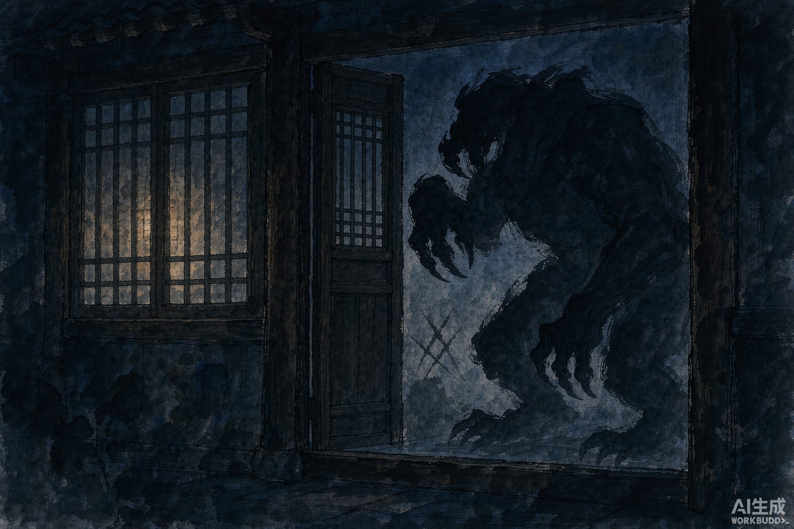

孙太白讲过一件他太爷爷的事。

那年他太爷爷在南山柳沟寺读书。麦收时回家住了十多天，再回寺里，推开书斋的门，桌上落满灰，窗上结满蛛网。他叫仆人来打扫，忙到天黑才收拾干净。铺好床，插上门闩，躺下。月光已经照满窗子。

翻来覆去睡不着，四下静得没有一丝声音。忽然风声隆隆，寺里的山门豁然一响。他心想：和尚忘了关门。念头还没落，风声已经近到屋前，房门自己开了。他起了疑心，还没想明白，声音已经进了屋，接着是靴子踩地的铿铿声，一步一步朝卧室门过来。

到这时候他才怕起来。

卧室门被推开。一个大鬼弯腰挤进来，直起身站在床前，跟房梁一般高。脸像熟透的老瓜皮，眼睛忽闪忽闪，满屋扫视；嘴张开来有盆大，稀稀落落几颗牙，三寸来长；舌头一动，喉咙里发出呵喇呵喇的响声，震得四壁发颤。

他怕到极点，又想：这么近，逃是逃不掉的，不如趁势给它一刀。手悄悄摸到枕下那把佩刀，猛地抽出，一刀砍在鬼的肚子上——声音像敲在瓦罐上。

鬼大怒，伸出巨爪来抓他。他往下一缩，鬼没抓着人，抓到了被子，攥着就往外拖，气冲冲地走了。他连人带被从床上滚下来，趴在地上喊叫。

家人举着火赶来，门关得好好的，只好推开窗翻进来，看见他这样都吓坏了。把他扶上床，他才说出经过。大家一看，被子夹在卧室门的缝里。开门照着看——门板上留着几道爪痕，大得像簸箕，五个指头按到的地方全穿透了。

天亮之后，他不敢再住，背着书箱回了家。后来问寺里的和尚，寺里再没有出过别的怪事。
