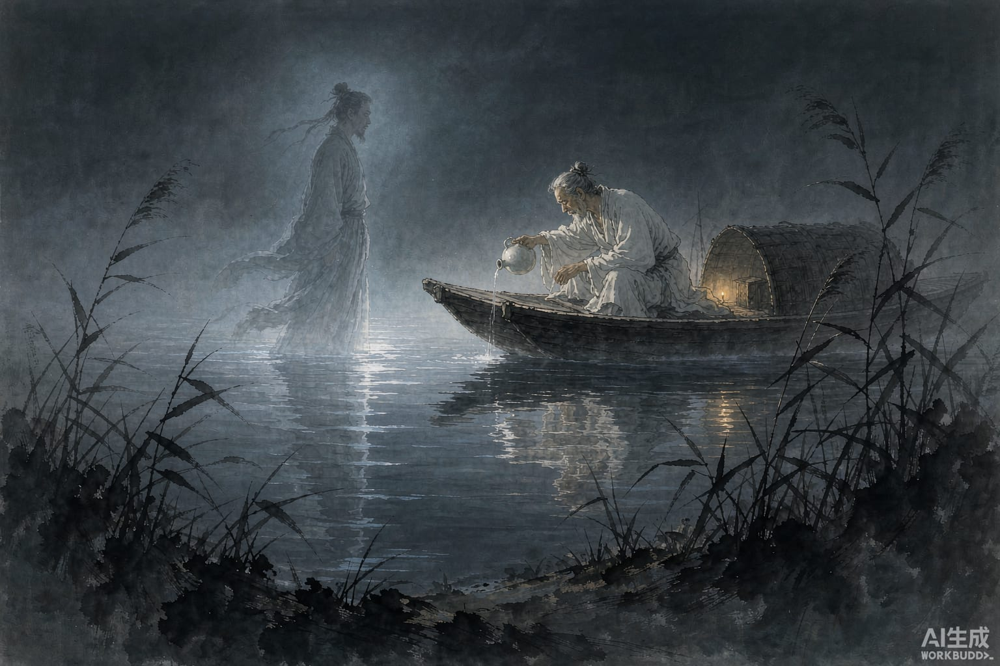

淄川北郭有个姓许的渔人。每夜带酒到河边，一边喝一边下网。喝之前先把酒酹在地上，念一句：河中溺鬼得饮。天天如此。

别人在这条河里打不着鱼，他独独满筐。

一晚他正独酌，来了个少年，在旁边徘徊。让他喝，就一起喝。偏偏这晚一条鱼也没有，姓许的正失望，少年起身说，我去下游替你把鱼赶过来。去了一趟回来：鱼大至矣。果然听见河里唼呷有声，一网下去，几条鱼都是一尺多长。

姓许的要把鱼送他，他不收：屡次喝你的好酒，这点事算不上报答。往后还来。问他姓名，他说：姓王，没有字，见面就叫我王六郎。

第二天姓许的卖了鱼，多打了些酒。晚上到河边，少年已经先在。喝几杯，就替他赶一趟鱼。

这样过了半年。一天少年忽然说要分别。欲言又止，最后说破了：我实在是个鬼。生前爱酒，喝醉了淹死在这条河里，好几年了。你的鱼比别人多，都是我在暗里赶的，报你那杯酹地的酒。明天我的业满了，有人来替我，我要去投生。今晚是最后一聚。

姓许的惊了一下，到底处得久了，不怕了，反倒跟着叹气。问替的是谁。少年说：明天中午，河上有个女子渡河落水，就是她。

第二日，姓许的守在河边。果然来了个妇人，抱着婴儿，到河边就掉了下去。孩子被抛在岸上，扬手蹬脚地哭。妇人在水里沉了几回、浮了几回，忽然浑身淋淋地扒着河岸爬上来，坐在地上缓了口气，抱起孩子走了。

妇人落水的时候，姓许的很不忍，几乎要奔过去救，转念想到这是替六郎的，忍住没动。等她自己爬上岸，他又疑心六郎的话不灵了。

傍晚照旧打鱼。少年又来了：今晚还见面，不提分别的话了。女子已经来替我了。我怜她怀里抱着个孩子——替我一人，要搭上两条命，就放了她。下一次替我的不知道等到什么时候，也许咱们俩的缘还没尽。

姓许的说：这个心，可以通到上天那里去。

又过了几天，少年又来告别。这回不是有人替死——那一念恻隐，上天已经知道了，授他为招远县邬镇的土地，明天赴任。姓许的说：人神两路，我去哪见你？少年说：你只管来。

姓许的收拾行装往东去。妻子笑他：几百里路，就算真有那个地方，你跟泥像怎么说话。他不听，到了招远，果然有个邬镇。找到那里，住进客店，问土地祠在哪。店主人惊了：客人莫不是姓许？又问：莫不是淄川来的？答了两个「然」。主人不答话，忽然跑出去。片刻间，男人抱着孩子，媳妇姑娘挤在门口，四面围上来。众人说：前几夜全镇做了同一个梦，土地神讲，淄川有位姓许的朋友要来，请大家资助他盘缠。等您好些天了。

姓许的到祠里祭告：别后一直惦记，远路践约。又蒙你托梦给镇上人，心里感激。没什么厚礼，只有一杯酒，像从前河上那样喝了吧。祝完烧了纸钱，风从神座后头起来，旋了半天才散。

当夜梦见六郎，衣冠楚楚，大不相同。他道谢说：有劳你远来，喜泪交加。只是担了这份职，不便会面，咫尺之间像隔着山河。镇上人送的东西你收下。临走那天，我来送。

住了几天他要回去，镇上人朝请暮邀地留，最后实在留不住，各自送礼，一个早上就装满了一口袋。送出村口，一阵旋风平地起来，跟着他走了十多里。姓许的拜了两拜：六郎珍重，不要远送了。你心仁爱，自会造福一方，不用老朋友嘱咐。风在地上盘旋了好一阵，才散。

他回到家，日子渐渐宽裕，不再打鱼了。后来碰见招远人，问起那位土地，都说灵验得很。也有人说，他的任所其实在章丘的石坑庄——不知道哪个对。
