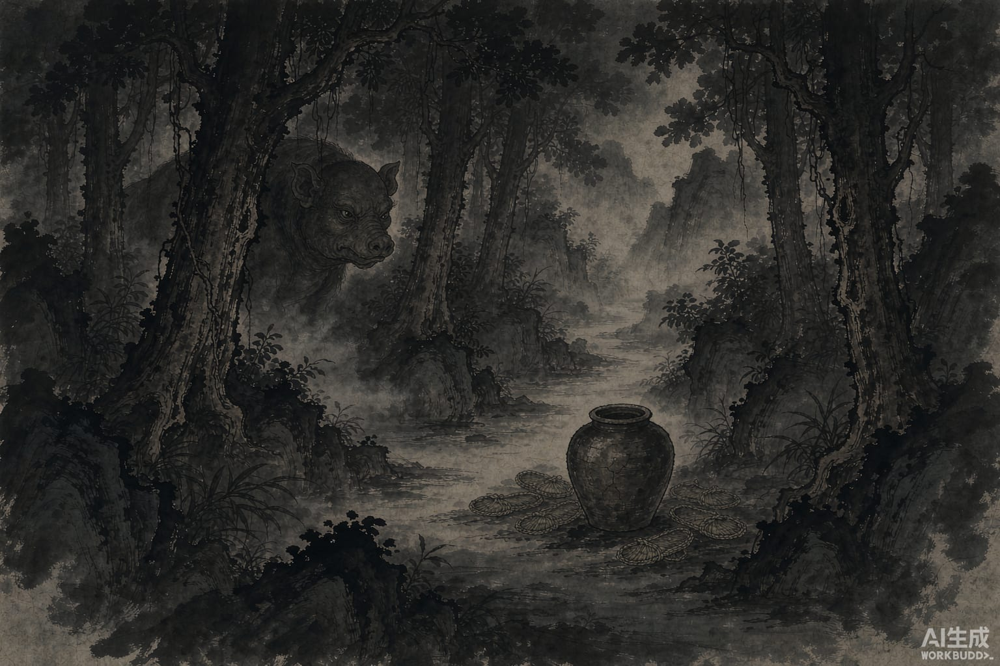

《山海经》里记过南方的一种野兽，叫狌狌。它长得像猪，脸却是人的脸。

书里给了它一句很特别的评语：狌狌知人名。

它知道人的名字。

这件事细想有点渗人。你走在一片山林里，忽然听见有人喊你的名字，声音就在几步之外，回头一看，是什么东西，你看不清。它叫什么，你知道它知道。

古人对它的本事还有个更细的说法：狌狌知往，不知来——过去的事它都记得，将来的事它不知道。

所以它能叫出你的名字，因为那是已经发生过的事。

后来的人有了对付它的办法。这个办法记在《蜀志》里，也在不少别的书里：南方封溪那地方产狌狌，本地人不用猎网，不用弓箭。他们往路边摆几坛酒，再放几十双草鞋，鞋和鞋用绳子串起来。

然后躲起来等。

狌狌来了。它们看见酒，看见鞋，立刻就明白了——这是要捉我们。

它们开始骂。骂得很难听，指名道姓地骂，把那家人的祖上三代都数一遍，说，你们想害我，我才不上当，我走了。

骂完，走了。

过了一会儿，又回来了。还是骂。再走。

就这样来回几趟。最后它们商量：那就尝一口吧，就一口。

一口下去，是甜的。再喝，还甜。

喝到脸红，有人顺手把草鞋穿上了脚。草鞋是串在一起的，一穿，走不动了。

一坛酒，一双鞋，几百只狌狌，一只没跑掉。

我小时候听这样的故事，只当笑话听。后来再读，笑不太出来。

整件事里，没有谁用什么法术。猎人只做了一件事：它知道狌狌什么都明白。知道酒是诱饵，知道鞋是陷阱，知道来的人想干什么。

所以猎人什么也不做，只把东西放在那儿。

倒是屈原问过一句很重的话。他在《天问》里写：猩猩能说话，可它又有什么过错呢？被关进笼子，等着下锅。

它确实没做错什么。它甚至什么都没拿，只是想尝一口甜的东西。
