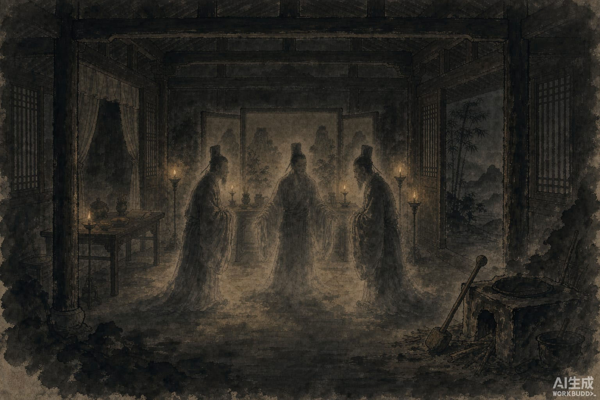

魏郡有个叫张奋的人，家里本来非常有钱。忽然家道败落，只好把大宅子卖了。

买主住进去，全家生病，吓得赶紧转卖。最后房子落到一个叫何文的人手里。

何文胆子大。他一个人，带一把大刀，傍晚进了宅子，爬上正屋的房梁，躲起来等。

三更天，门开了。进来一个人，一丈多高，戴着高冠，穿黄衣。他站在堂上，喊了一声：

"细腰！"

屋里有个声音应道："哎。"

黄衣人问："屋里怎么有生人的气味？"

细腰答："没有啊。"

黄衣人站了一会儿，走了。没过多久，又进来一个高冠青衣的，再过一个时辰，高冠白衣的。每个人进来，都先喊"细腰"，问的答的都是同样的话。

天快亮了，何文从梁上下来，学着他们的样子，朝屋里喊：

"细腰！"

细腰应了。这回换何文来问：

"刚才那穿黄衣的，是谁？"

"是金子，埋在堂屋西墙下面。"

"穿青衣的呢？"

"是铜钱，在堂前井边五步。"

"穿白衣的呢？"

"是银子，在墙角柱子底下。"

"那你又是谁？"

"我啊，我是捣米的木杵，就在灶台下边。"

何文等到天亮，按着问出来的位置，一处一处挖。挖出金银五百斤，铜钱千万贯。最后把那根木杵从灶下拖出来，烧了。

从此宅子里清清静静，何文也发了大财。

更妙的是，满屋子"妖怪"，闹了半夜，其实一个活的都没有——黄金、白银、铜钱，还有一根木杵。它们每到夜里就互相点名，喊来喊去。

何文没念咒，没画符，也没跟任何一个妖怪交手。他只是躲在梁上，安安静静听了一夜，学会了它们之间的称呼。

天亮后照着喊一声，金子银子，自己就报了账。刀一夜没出鞘。
