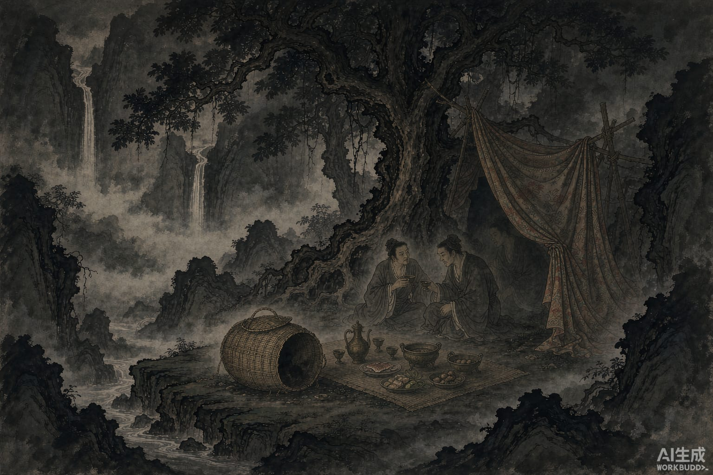

许彦挑着两只鹅，走在绥安山里。

路边躺着一个人，十七八岁，书生打扮，说是脚痛走不动了，想进他的鹅笼里待一段。许彦当他说笑。书生起身就钻了进去——笼子没变大，人也没变小，跟两只鹅并排坐着，鹅一点都不惊。许彦挑起笼子继续走，肩上一点也不觉得沉。

走到一棵大树下歇脚，书生从笼里出来，说要请他吃顿便饭。

他从嘴里吐出一个铜盒子，盒子里整整齐齐摆着酒菜，器皿都是铜的，味道好得不像人间的东西。喝了几轮酒，书生说：我出门时带了个妇人，如今想请她出来坐坐。又从嘴里吐出一个女子，十五六岁，衣裳华丽，生得极美，三个人一同吃喝。

不久书生动了醉意，躺下睡了。

那女子转头对许彦说：我跟他做了夫妻，心里其实怨他。我也偷偷带了个男子同行，趁他睡着，叫他出来一会儿，你别说话。许彦说好。女子从嘴里吐出一个男子，二十三四岁，聪明讨喜，跟她对坐说话。书生的身子动了动，像要醒，女子吐出一道锦帐把书生遮住，自己进去陪他睡。

那男子这时也对许彦开口了：这女子虽说有情，心也不全在我身上，我另外还带了个女人，想见一面，你千万别漏出去。许彦说好。男子嘴里又吐出一个妇人，二十来岁，三个人一起喝酒说笑，说了很久。

听见书生那边有动静，男子说：两位醒了。把自己吐出来的妇人收回嘴里。

一会儿，书生那边的女子出来，说书生要起了，把先前那个男子吞了回去，独自对着许彦坐。

书生起来，伸了个懒腰：这一觉睡得久了，让你一个人坐着，闷了吧？天也晚了，该分手了。他把女子和所有器皿一件件收回嘴里，只留下一只大铜盘，两尺来宽，送给许彦：没什么可谢你的，留个念想。

后来许彦做了兰台令史，把这只盘送给侍中张散。张散看盘底的铭文，上面刻着：永平三年造。

那是三百多年前的东西了。
