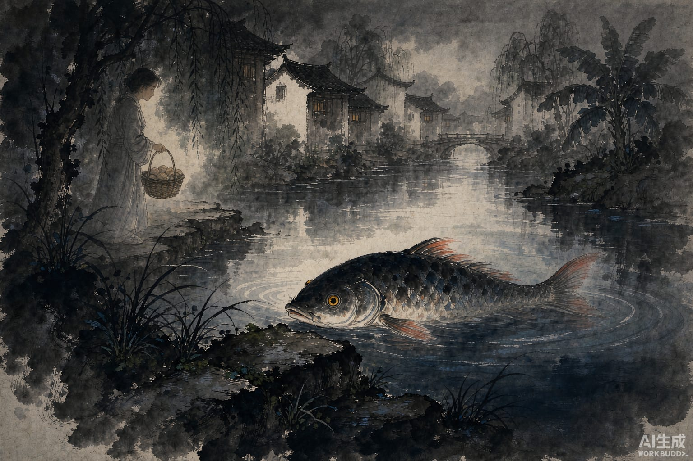

你大概听过灰姑娘：后母欺负她，仙女帮忙，舞会上丢了一只水晶鞋，王子拿着鞋找到她。

一千一百多年前，唐朝有个人叫段成式，把一个几乎一模一样的故事写进了书里。故事是他家一个老仆人讲的，老仆是广西一带的人。故事的主人公叫叶限。

叶限是南方一位洞主的女儿，父亲死后，被后母使唤着去砍险处的柴、挑深潭的水。

她养过一条鱼，起初才两寸长，红色的鳍，金色的眼睛。鱼一天天长大，盆换了一个又一个，最后放进了后院的池塘。叶限到了池边，鱼就把头浮出水面靠在岸上；别人来，它就沉下去不见。

后母知道了。她骗叶限去远处的泉眼挑水，自己穿上叶限的衣服，袖子里藏着刀，到池边唤鱼。鱼以为是叶限，浮出头，被杀了。

那条鱼已经长到一丈多长。

后母把鱼骨埋在粪土下面。叶限找不到鱼，在野外哭，忽然有个披发粗衣的人从天而降，告诉她：别哭，鱼骨在粪下，你收好，想要什么，向它求。

叶限照做了。要什么有什么。

后来到了洞节，就是那地方最热闹的节庆。后母带着亲女儿去了，让叶限看家。叶限等她们走远，向鱼骨求得一件翠色上衣、一双金鞋，也去了。

节上被后母的女儿认出来，她急忙往回跑，跑丢了一只金鞋。

鞋被卖到海岛上的陀汗国。国王让人试穿，脚最小的也差一寸；让全国的妇人试，没有一个合脚。这鞋轻得像根羽毛，踩在石头上没有声音。国王按着鞋的来路一路找过去，找到了叶限。她穿上鞋，穿上翠衣走出来，书上写她"色若天人"。

后母和她的女儿，后来被飞石击死。

到这里，故事和灰姑娘一样结束了。

但它还有个尾巴。陀汗王娶了叶限，也得了鱼骨。第一年要什么有什么，宝玉无限。第二年，鱼骨不应了。国王把鱼骨葬在海边，拿一百斛珍珠陪着埋，用金子圈起来。后来打仗缺军费，他想挖开它。

那天夜里，海潮上来，连金带珠，把鱼骨全卷走了。

灰姑娘的童话在婚礼就结束了。中国的这个版本，多讲了一章：嫁给王子不是结尾，贪心才是。
