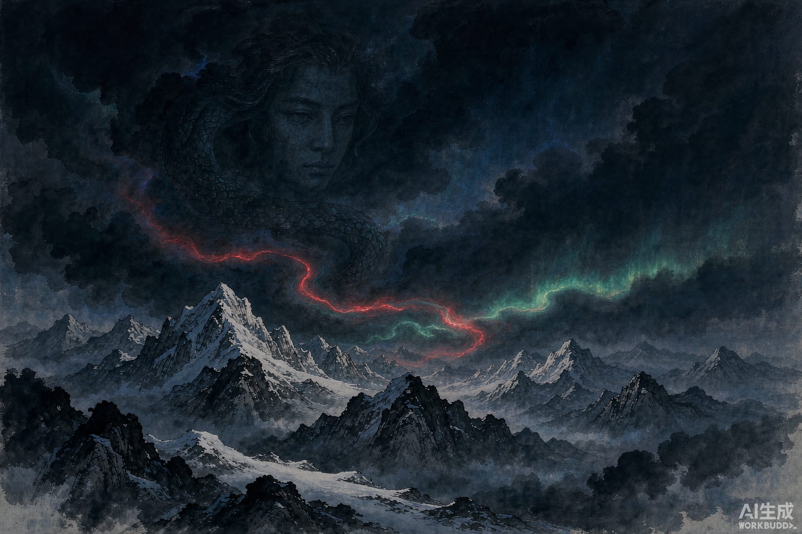

往北走，走到太阳能照到的地方为止，再往前，是章尾山。

《山海经》里写，那地方在西北海之外、赤水的北边。山上有神，人的脸，蛇的身子，通身赤红。眼睛竖着长，书上写作「直目正乘」。它闭上眼睛，天下就黑；睁开眼睛，天下就亮。不吃，不睡，也不呼吸，风雨都由它招来。它照亮的是最深最暗的地方，所以叫烛龙，又叫烛九阴。

同一部书的《海外北经》另有一段，说钟山的山神名叫烛阴。睁眼是白天，闭眼是黑夜；吹气是冬天，呼气是夏天；不喝，不吃，不喘气，一喘气就起风。身长千里，住在钟山脚下。

两段隔着一整部书，位置一个在西北，一个在东北，写法也不一样。晋代的郭璞给《山海经》作注，说这两个是同一个。

一千里有多长，写书的人大概也没量过。他只知道天从这头黑到那头，中间没有过渡——这边还亮着，那边已经全黑了。要有这么长的一条东西横在上面，这件事才说得通。

屈原在《天问》里问过一句：「日安不到，烛龙何照？」太阳照不到的地方，烛龙照的又是什么。

问题问得很直白。汉代的王逸注这一句，说天西北有个幽冥无日的国，有条龙口里衔着蜡烛去照它。到了郭璞，蜡烛换成了火精，他引《诗含神雾》说，天在西北缺了一块，没有阴阳消长，所以有龙衔着火精去照天门。一个衔蜡烛的龙，就这样一年年长成了管昼夜的神。

李白也写过它：「烛龙栖寒门，光曜犹旦开。日月照之何不及此？惟有北风号怒天上来。」后面接的是「燕山雪花大如席，片片吹落轩辕台」。他问的还是那件事——日月都到不了，那里凭什么还有光。

现在的人说，北方天上确实有光。冬天的夜里，一条光带横过整个天，红一阵绿一阵，会走，会散，散了又聚起来，落在雪原上，像天亮了一下又暗下去。这样的光，一年能看见好些回。

古人没有「极光」这个词。他们看见天上有东西在发光，地上没有人点它，那就只能是有个什么，正在睁眼。

那条光带现在还在天上走。没有人点它。它自己亮着。
