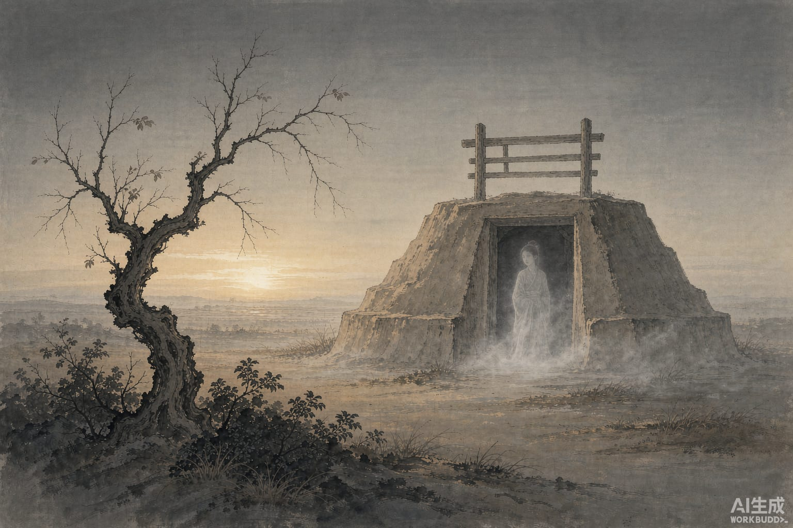

这桩婚事，吴王没点头。

吴王夫差的小女儿叫紫玉，年方十八，看上了一个读书的年轻人，韩重。两人私下通信往来，紫玉许下话，要嫁他。韩重要去齐鲁游学，临行托父母上门提亲。吴王一听就恼了，不许。

紫玉郁结在心，人就这么没了，葬在阊门外头。

三年后韩重学成回来，去问紫玉的父母，才知道人已经不在了。他备了祭品，到坟前哭祭。

坟前烟雾一动，紫玉从墓里走出来。

她哭着说起从前：你走之后，我托二老去求亲，满心以为能成，没想到大王不许，我的名分就毁在自己手里。你如今远道回来，听说我死了，还肯备了祭品来坟上哭我，这份情是真的。

她想拉韩重的手，韩重迟疑着不敢。紫玉说：你我都到了这个地步，一个在阳世，一个在墓里，还计较什么。韩重这才握住。她在墓中摆酒相待，留了三天三夜，尽夫妇之礼。临别时，她取出一对明珠说：死了的人没什么可送你，这个你收下。见了大王，替我把冤说一声。

韩重拿明珠去见吴王，把事情原原本本讲了。吴王大怒：我女儿早死了，你编出这种话来，分明是掘了坟偷了宝，拿鬼神遮掩。喝令左右拿下韩重。韩重脱身跑出来，又回到坟前诉苦。紫玉说：别怕，我自己去说。

吴王正在梳妆，忽然看见女儿立在面前，又惊又喜，问她：你怎么活过来了？紫玉跪下说：从前韩重来求亲，大王不许，我自尽身亡。他从远方回来，闻我已死，备了祭品来坟上吊唁。我念他这份心，与他见了一面，赠了一对明珠。坟没有动过，请大王不必疑心。

王夫人在屋里听见，抢出来一把抱住女儿。

怀里的人散了，成了一缕烟。
